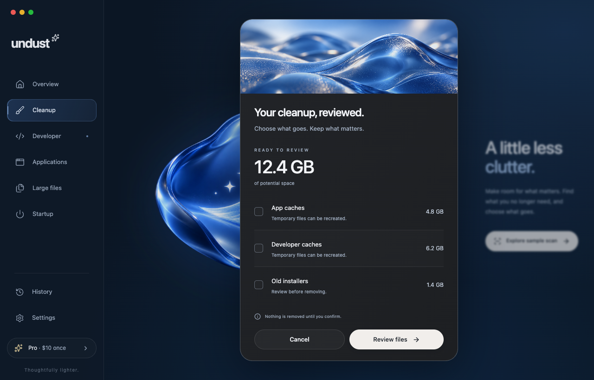

# Undust

**A little less clutter.** A considered Mac cleanup app with useful free tools and a proposed **$10 one-time Pro upgrade**.



## Project status

A working early desktop build is available in source. The interface follows the approved blue-glass direction and includes ambient motion, a sample cleanup journey, folder scanning, file review, local history/settings, and read-only app inventory. Eligible selected personal files can use an explicit Trash flow; caches remain review-only. Pro checkout and production signing are pending. See the [implementation record](docs/work/desktop-foundation.md) for validation and current limits.

## Run locally

Requires Node.js 22.12+ and npm. Desktop builds additionally require a stable Rust toolchain and Apple Command Line Tools on an Apple silicon Mac.

```sh
npm ci
npm run dev
```

The browser opens a labeled sample workspace at `http://127.0.0.1:1420`. Browser mode never accesses or removes real local files.

```sh
npm run desktop:dev
npm run desktop:build
```

Desktop mode scans folders you select; Settings also offers the sample workspace. The native launcher finds a standard Rust installation without changing your shell settings. Bundles are written under `src-tauri/target/release/bundle/macos/`. Local builds are ad hoc signed and are not a public release.

## Checks

```sh
npm run build
npm test
npm run test:native
```

Browser tests currently use installed Google Chrome. Install Chrome before running them; `npx playwright install webkit` supplies the optional WebKit engine for additional checks. Native tests use temporary fixture directories and an isolated mutation adapter.


## Start here

- [Delivery plan](plan.md): design-to-release milestones, dependencies, and completion gates.
- [Working workflow](work.md): how each design and development task is implemented, checked, and handed off.
- [Product requirements](prd.md): audience, scope, pricing, safety, technical direction, and launch gates.
- [Feature specification](feature.md): Free/Pro boundaries, behavior, edge cases, and acceptance criteria.
- [Design direction](design.md): approved visual target and implementation handoff.
- [UI/UX and content](docs/ui-ux.md): screens, shadcn components, visual tokens, motion, accessibility, and exact interface copy.
- [Research and evidence](docs/research.md): public CleanMyMac analysis, sources, REA setup status, and unresolved questions.
- [Assets](assets/README.md): brand masters, shared tokens, dimensions, and integrity manifest.
- [Design gallery](design/README.md): interface, wordmark, and icon previews.

## Implementation

React + TypeScript, shadcn/ui, Tailwind CSS, and Motion for the interface; Tauri 2 with a small Rust/macOS service layer for desktop access. The initial architecture is implemented; release performance budgets are not yet benchmarked. Native macOS window controls, menus, file selection, permissions, and Trash behavior should complement the custom interface.

## Product principles

- Explain every cleanup suggestion.
- Review before removal; personal files start unselected.
- Keep scanning and file metadata on the device.
- Distinguish potential cleanup size from actual storage recovered.
- No fear-based health score, forced RAM clearing, or guaranteed speed claims.
- Use original branding and implementation; no competitor code or assets are included.

## Commercial status

Free and Pro packaging is proposed in the PRD. No checkout is live. End-user terms and third-party notices must be finalized before distribution.

## License

Undust is **proprietary — all rights reserved**, subject to applicable law and the exceptions in [LICENSE](LICENSE). This repository does not grant open-source reuse permission. See [third-party notices](THIRD_PARTY_NOTICES.md). Third-party material retains its own license, and GitHub's platform permissions remain applicable. The Free/Pro application terms will be provided separately; purchasing the application does not itself grant source-code redistribution rights.
