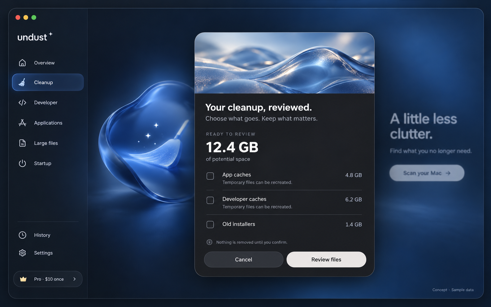
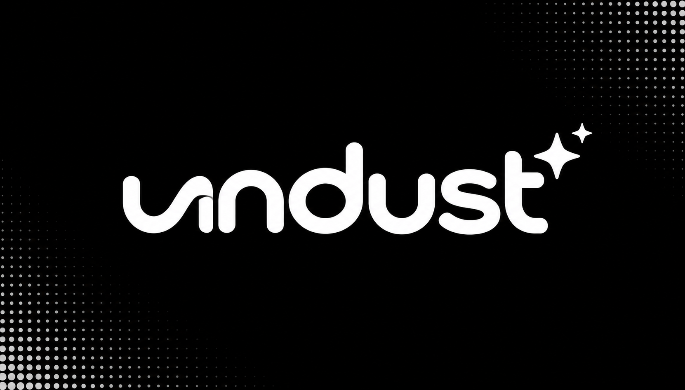

# Undust design assets

See the root [design direction](../design.md) for implementation guidance and the [asset guide](../assets/README.md) for canonical files and metadata.

## Approved interface direction

Navy glass background, translucent navigation, charcoal review dialog, icy glass banner, and restrained pill actions. The owner approved this concept on October 18, 2026. Implement the layout using real shadcn components and Motion; the image is not an executable interface. Sample data totals 12.4 GB.

## Wordmark concept

Custom rounded lowercase lettering and sparkle motif, generated from a user-supplied stylistic reference. This remains a raster concept, not a final vector trademark. The flowing first letter should receive a legibility pass before release. The approved UI uses a simpler readable wordmark treatment; unify both during production identity work.

## App icon concept

Blue glass tile, luminous sweep, and small sparkles inspired by the approved interface artwork. Transparent canvas outside the tile; verify actual output alpha and small-size clarity before production. This is the concept master. Generated macOS icon resources are now in `src-tauri/icons/`; they still require a production visual review.

## Production checklist

- Rebuild wordmark as editable vector paths with optical kerning.
- Refine icon at Dock and menu sizes; simplify detail where needed.
- Prepare current macOS app-icon assets and verify masking and safe area.
- Create separate background/banner artwork; do not flatten interactive controls into images.
- Provide solid backgrounds and reduced-effects alternatives.
- Review brand availability and third-party license notices before launch.

Generated concepts are original task outputs. Reference screenshots and competitor assets are not distributed in this repository.
